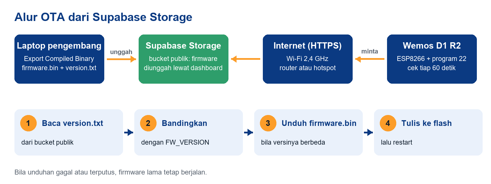
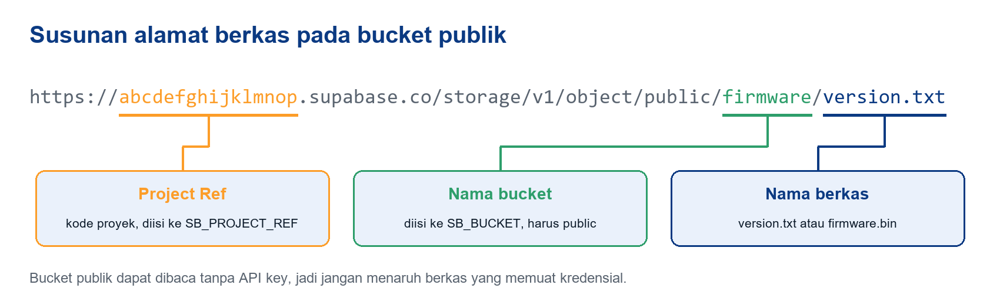
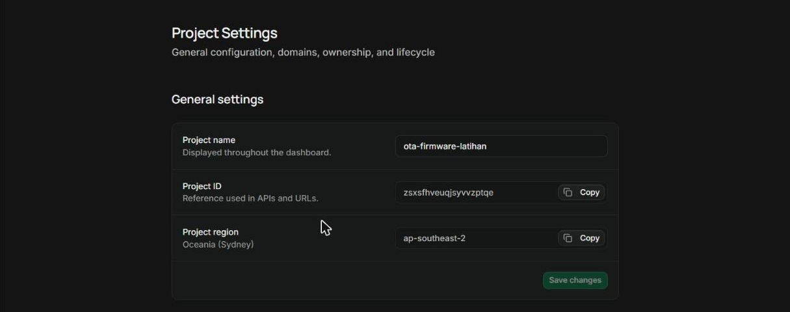
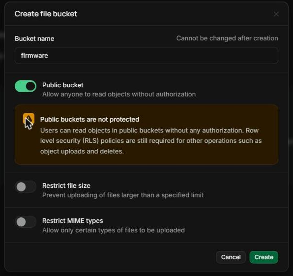
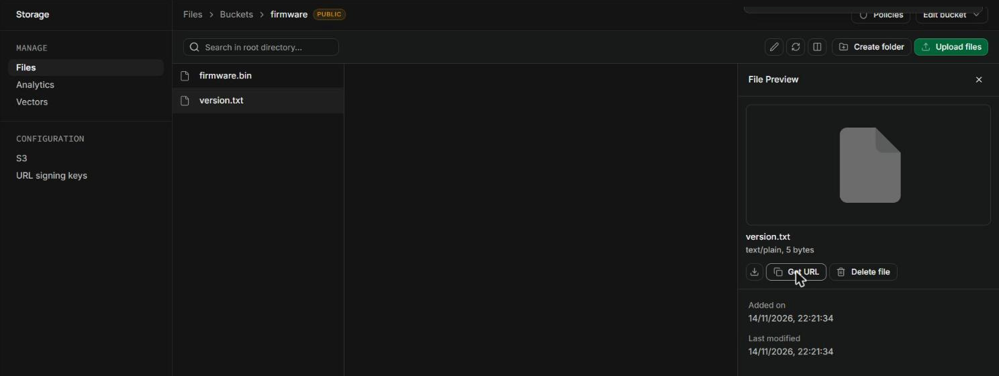

# 4. Melakukan Instalasi Firmware Secara Over The Air (OTA)

| | |
| --- | --- |
| **Kode unit** | J.61IOT01.019.1 |
| **Judul unit** | Melakukan Instalasi Firmware pada Perangkat (Device) Secara Over The Air (OTA) |
| **Deskripsi unit** | Unit kompetensi ini berhubungan dengan pengetahuan, keterampilan, dan sikap kerja yang dibutuhkan dalam melakukan instalasi firmware pada perangkat (device) secara Over The Air (OTA) yang sesuai permintaan atau kebutuhan. |

<figure><figcaption></figcaption></figure>

## Peta kompetensi

| Elemen kompetensi | Kriteria unjuk kerja (KUK) | Dijawab pada bagian | Bukti kerja |
| --- | --- | --- | --- |
| 1. Merancang sistem instalasi firmware pada device IoT secara OTA | 1.1 Rancangan sistem manajemen perangkat lunak (firmware) IoT yang mendukung instalasi secara OTA dituangkan ke dalam dokumen tertulis. | Bagian 2 | Dokumen Rancangan OTA |
| | 1.2 Faktor-faktor yang mempengaruhi tingkat keberhasilan dari instalasi firmware secara OTA dituangkan ke dalam dokumen tertulis. | Bagian 1.4 dan 2 | Dokumen Rancangan OTA |
| | 1.3 SOP dan kaidah-kaidah dalam proses pemasangan firmware secara OTA dituangkan ke dalam dokumen tertulis. | Bagian 2 | SOP OTA |
| 2. Menyiapkan sistem instalasi firmware pada device IoT secara OTA | 2.1 Fungsionalitas sistem manajemen firmware secara OTA dibangun sesuai dengan kebutuhan. | Bagian 4 sampai 6 | OTA lokal dan OTA Supabase Storage berjalan |
| | 2.2 Dokumentasi penggunaan sistem manajemen firmware disiapkan sesuai standar yang ditetapkan. | Bagian 2 dan 6 | SOP OTA, catatan rilis |
| 3. Melakukan instalasi firmware pada device IoT secara OTA | 3.1 Infrastruktur software untuk mendukung instalasi firmware secara OTA ditanam pada perangkat IoT. | Bagian 4 | Program 16 ter-upload |
| | 3.2 Infrastruktur jaringan IoT untuk mendukung instalasi firmware secara OTA dipastikan berjalan sesuai dengan SLA. | Bagian 7 | Lembar pemeriksaan jaringan |

Aspek kritis unit ini adalah kecermatan dalam merancang dan menyiapkan sistem manajemen firmware, terutama penanganan kemungkinan gagal. Perhatikan bahwa tiga dari tujuh KUK meminta **dokumen tertulis**. Peserta yang hanya mendemonstrasikan OTA tanpa dokumen rancangan dan SOP belum memenuhi unit ini.

## 1. Landasan Teori

### 1.1. Memori pada ESP8266

Wemos D1 R2 memiliki flash sebesar 4 MB yang dibagi menjadi beberapa area berikut.

| Area | Isi | Terhapus saat upload program baru? |
| --- | --- | --- |
| Sketch | Program yang sedang berjalan | Ya, ditimpa |
| Ruang kosong setelah sketch | Tempat sementara firmware baru saat OTA | Dipakai saat OTA |
| EEPROM (emulasi) | Data yang disimpan program dengan library `EEPROM`, misalnya konfigurasi Blynk Edgent | Tidak |
| Konfigurasi SDK | SSID dan password Wi-Fi, tetapi hanya bila program memakai `WiFi.persistent(true)` | Tidak |

ESP8266 tidak memiliki chip EEPROM (*Electrically Erasable Programmable Read-Only Memory*), sehingga library `EEPROM` meminjam satu sektor flash dan memperlakukannya seperti EEPROM. Data di sektor itu bertahan walaupun perangkat dimatikan dan walaupun program diganti.


**Perhatian.** Pada paket ESP8266 Arduino core 3.1.2, `WiFi.persistent()` bernilai `false` secara bawaan. Akibatnya `WiFi.begin(ssid, password)` **tidak** menyimpan SSID dan password ke flash, dan sesudah restart `WiFi.SSID()` kosong. Kredensial baru tersimpan di konfigurasi SDK bila program memanggil `WiFi.persistent(true)` sebelum `WiFi.begin(...)`. Hasil ini diuji pada Wemos D1 R2 dengan core 3.1.2. Core lama memiliki nilai bawaan yang berbeda.


### 1.2. Mengapa konfigurasi lama perlu dihapus

Perangkat bekas pakai dapat masih menyimpan nama dan password Wi-Fi pemilik sebelumnya, misalnya konfigurasi Blynk Edgent di EEPROM, atau konfigurasi SDK bila program lama memakai `WiFi.persistent(true)`. Sebelum perangkat dipasang di tempat baru, data itu dihapus dengan dua alasan: mencegah kebocoran kredensial jaringan, dan mencegah perangkat mencoba terhubung ke jaringan lama.

### 1.3. Cara memperbarui firmware

| Cara | Jalur | Kapan dipakai |
| --- | --- | --- |
| Kabel USB | Serial lewat chip CH340 | Pengisian pertama, atau ketika OTA gagal total |
| OTA (*Over The Air*) | Wi-Fi | Perangkat sudah terpasang dan sulit dijangkau |

Pada OTA, perangkat mengunduh firmware baru ke ruang kosong di flash sambil tetap menjalankan firmware lama. Setelah unduhan lengkap dan lolos pemeriksaan, perangkat restart dan *bootloader* menyalin firmware baru ke area sketch. Jika unduhan terputus di tengah jalan, firmware lama tetap utuh.

Ada beberapa arsitektur OTA, dan tiga di antaranya akan dipraktikkan pada modul ini.

| Arsitektur | Cara kerja | Kelebihan | Keterbatasan | Dipraktikkan di |
| --- | --- | --- | --- | --- |
| ArduinoOTA | Laptop mendorong (*push*) firmware ke perangkat lewat jaringan lokal | Paling sederhana, tidak perlu internet | Laptop dan perangkat harus berada di jaringan yang sama, satu perangkat per upload | Bagian 4 dan 5 |
| HTTP update dari Supabase Storage | Perangkat menarik (*pull*) firmware sendiri dari internet | Tidak bergantung pada platform IoT, berlaku untuk banyak perangkat sekaligus, tersedia pada paket gratis | Perlu internet, bucket harus public, perlu aturan versi dan arsip `.bin` yang disiplin | Bagian 6 |
| Layanan platform (Blynk.Air) | Platform mengirim firmware ke perangkat pilihan lewat cloud | Ada pemilihan target, pemantauan progres, dan pemeriksaan versi | Terikat pada platform dan paket langganannya | Bab 6 dan 8 |

Selain ketiganya, firmware juga dapat ditarik dari server HTTP milik perusahaan sendiri dengan library yang sama seperti pada Bagian 6, atau di-upload lewat halaman web yang disajikan perangkat (`ESP8266HTTPUpdateServer`).

### 1.4. Faktor yang memengaruhi keberhasilan OTA

| Faktor | Risiko bila diabaikan | Antisipasi |
| --- | --- | --- |
| Ruang flash | Firmware baru tidak muat di ruang kosong, OTA ditolak | Ukuran firmware tidak lebih dari separuh area sketch. Ukuran tampil di Arduino IDE setelah compile |
| Kekuatan sinyal | Unduhan terputus di tengah jalan | Tunda OTA bila RSSI di bawah -80 dBm |
| Catu daya | Perangkat mati saat menulis flash | Pastikan catu daya stabil, jangan OTA saat baterai lemah |
| Jaringan | Router memblokir mDNS atau memisahkan antarperangkat (*AP isolation*) | Uji di hotspot sendiri, minta pengecualian pada admin jaringan |
| Firmware baru tidak memuat kode OTA | Perangkat tidak dapat diperbarui lagi tanpa kabel | Kode OTA wajib ada di setiap versi firmware |
| Autentikasi | Orang lain di jaringan yang sama mengganti firmware | Pasang password OTA, pakai HTTPS |
| Versi | Perangkat memasang firmware yang sama berulang-ulang | Nomor versi dinaikkan di setiap rilis dan dicatat |
| Integritas berkas | Firmware rusak terpasang | Pemeriksaan MD5 atau tanda tangan digital |

## 2. Langkah Kerja 1: Menyusun Rancangan dan SOP OTA

Tulis dua dokumen berikut di portofolio sebelum mulai praktik, dan isinya boleh Anda perbarui setelah praktik itu selesai.

**DOKUMEN RANCANGAN SISTEM OTA**

| Butir | Isian |
| --- | --- |
| Perangkat sasaran | Wemos D1 R2 (ESP8266), flash 4 MB |
| Jumlah perangkat dan lokasinya | Contoh: 1 unit di meja praktik. Tuliskan juga skenario 50 unit di lokasi klien |
| Arsitektur yang dipilih | ArduinoOTA / Supabase Storage / Blynk.Air, beserta alasan pemilihannya |
| Gambar alur | Dari laptop pengembang sampai firmware berjalan di perangkat. Boleh digambar tangan lalu difoto |
| Koneksi yang dibutuhkan | Contoh: Wi-Fi 2,4 GHz, akses internet ke supabase.co |
| Aturan versi | Contoh: MAJOR.MINOR.PATCH, dinaikkan di setiap rilis |
| Pengamanan | Contoh: password OTA, HTTPS, firmware tanpa kredensial |
| Faktor keberhasilan dan antisipasinya | Pilih yang relevan dari tabel pada Bagian 1.4 |
| Penanganan gagal | Contoh: firmware lama tetap berjalan, ulangi OTA. Jika tetap gagal, upload lewat USB |

**SOP PEMASANGAN FIRMWARE SECARA OTA**

Contoh berikut dapat Anda pakai sebagai titik awal, lalu sesuaikan dengan arsitektur yang dipilih.

1. Pastikan firmware baru sudah diuji pada satu perangkat uji lewat USB.
2. Pastikan firmware baru masih memuat kode OTA.
3. Naikkan nomor versi dan tulis perubahan pada catatan rilis.
4. Periksa ukuran firmware pada hasil compile.
5. Periksa kondisi perangkat sasaran: online, RSSI minimal -80 dBm, catu daya stabil.
6. Kirim firmware ke satu perangkat lebih dulu, lalu amati sampai perangkat kembali online.
7. Verifikasi versi dan fungsi firmware baru pada perangkat tersebut.
8. Lanjutkan ke perangkat lain secara bertahap.
9. Jika gagal, jalankan penanganan gagal sesuai rancangan, lalu catat kejadiannya.
10. Arsipkan berkas `.bin` setiap versi yang pernah dirilis.

## 3. Langkah Kerja 2: Menghapus Konfigurasi Lama

Program berikut menulis angka 0 ke seluruh 512 byte EEPROM, lalu menghapus kredensial Wi-Fi yang disimpan SDK.



#### Hubungkan perangkat

Hubungkan Wemos D1 R2 ke laptop dengan kabel micro USB, lalu buka Arduino IDE.



#### Buka program [`15.Reset_EEPROM`](https://github.com/robbywm/mySertifikasi-IOT/tree/main/15.Reset_EEPROM)

Kode lengkap juga tersedia di GitHub lewat tautan di atas.

```cpp
#include <EEPROM.h>

void setup() {
  Serial.begin(9600);
  
  // Mengalokasikan 512 bytes memori Flash untuk emulasi EEPROM
  EEPROM.begin(512); 
  
  Serial.println();
  Serial.println("Memulai proses pembersihan memori EEPROM...");

  // Melakukan perulangan untuk menulis nilai 0 pada setiap alamat byte
  for (int i = 0; i < 512; i++) {
    EEPROM.write(i, 0);
  }

  // Menyimpan perubahan secara permanen ke memori Flash
  EEPROM.commit(); 
  
  Serial.println("EEPROM bersih dari jejak konfigurasi lama.");

  // Bila program lama memakai WiFi.persistent(true), SSID dan password disimpan
  // SDK di sektor konfigurasi tersendiri (di luar EEPROM), jadi dihapus terpisah
  if (ESP.eraseConfig()) {
    Serial.println("Kredensial WiFi yang disimpan SDK juga sudah dihapus.");
  } else {
    Serial.println("Peringatan: Kredensial WiFi SDK gagal dihapus.");
  }
  Serial.println("Proses selesai.");
}

void loop() {
  // Tidak ada instruksi perulangan yang diperlukan
}
```




#### Upload dan periksa

Klik **Upload**, lalu buka Serial Monitor pada 9600 baud. Tekan tombol RESET pada board bila pesan belum terlihat. Pastikan muncul konfirmasi bahwa EEPROM dan kredensial Wi-Fi sudah dihapus.




**Untuk pemula.** Hasil yang sama dapat diperoleh tanpa program, yaitu dengan memilih **Tools > Erase Flash > All Flash Contents** sebelum meng-upload program apa pun. Opsi itu menghapus seluruh isi flash, sehingga kembalikan ke **Only Sketch** setelah selesai.


## 4. Langkah Kerja 3: Menanam Infrastruktur OTA lewat USB

Perangkat baru dapat menerima OTA setelah diisi firmware yang memuat kode OTA, sehingga pengisian pertama ini tetap memakai kabel USB. Sebagai penanda, firmware V1 menyalakan LED status D4 terus-menerus.

1. Buka program [`16.Injeksi_Awal_OTA`](https://github.com/robbywm/mySertifikasi-IOT/tree/main/16.Injeksi_Awal_OTA).
2. Ganti `ssid`, `password`, dan `sandiOTA` dengan milik Anda.


**Perhatian.** Banyak router kantor dan Wi-Fi publik memblokir mDNS (*Multicast DNS*) atau mengaktifkan AP isolation, sehingga perangkat tidak muncul di daftar port Arduino IDE. Pakai hotspot laptop atau smartphone, lalu hubungkan laptop dan Wemos ke hotspot yang sama.


Kode lengkap juga tersedia di GitHub lewat tautan di atas.

```cpp
#include <ESP8266WiFi.h>
#include <ESP8266mDNS.h>
#include <WiFiUdp.h>
#include <ArduinoOTA.h>

// Kredensial Jaringan (Sangat disarankan menggunakan Mobile Hotspot Laptop/HP)
const char* ssid = "NAMA_WIFI_HOTSPOT_ANDA";
const char* password = "KATA_SANDI_HOTSPOT_ANDA";

// Sandi OTA: tanpa sandi, siapa pun di jaringan yang sama dapat mengganti firmware
const char* sandiOTA = "GANTI_SANDI_OTA";

// Definisi Pin Status LED pada KasgarIoT
// Catatan: LED D4 menggunakan logika Active LOW
#define PIN_LED D4

void setup() {
  Serial.begin(115200);
  pinMode(PIN_LED, OUTPUT);

  // Firmware V1: Menyalakan LED statis sebagai tanda program awal
  // Menggunakan LOW karena sirkuit Active LOW
  digitalWrite(PIN_LED, LOW);

  // Koneksi ke Jaringan Wi-Fi
  WiFi.mode(WIFI_STA);
  WiFi.begin(ssid, password);
  while (WiFi.waitForConnectResult() != WL_CONNECTED) {
    Serial.println("Koneksi Wi-Fi gagal. Restart dalam 5 detik...");
    delay(5000);
    ESP.restart();
  }

  // Konfigurasi Identitas dan Sandi OTA di Jaringan
  ArduinoOTA.setHostname("mySertifikasi-OTA");
  ArduinoOTA.setPassword(sandiOTA);

  // Memulai Layanan OTA
  ArduinoOTA.begin();

  Serial.println("Firmware V1 siap menerima OTA.");
  Serial.print("Alamat IP: ");
  Serial.println(WiFi.localIP());
  Serial.print("Kekuatan Sinyal (RSSI): ");
  Serial.print(WiFi.RSSI());
  Serial.println(" dBm");
}

void loop() {
  // Mendengarkan permintaan OTA dari jaringan
  ArduinoOTA.handle();
}
```


3. Pilih port serial (COM) seperti biasa, lalu klik **Upload**.
4. Buka Serial Monitor pada **115200 baud**. Catat alamat IP dan RSSI yang tampil.
5. Amati LED status D4. LED menyala terus, tanda perangkat sudah terhubung ke jaringan dan siap menerima OTA.

Baris `ArduinoOTA.setPassword(...)` membuat Arduino IDE meminta password setiap kali ada upload lewat jaringan. Tanpa baris itu, siapa pun yang berada di jaringan yang sama dapat mengganti firmware perangkat Anda.

## 5. Langkah Kerja 4: OTA Lokal dengan ArduinoOTA

Sekarang firmware V2 akan dikirim tanpa kabel data. Firmware itu membuat LED D4 berkedip, sehingga keberhasilan OTA dapat dilihat dari perubahan perilaku LED.



#### Lepaskan kabel data

Cabut kabel USB dari laptop, lalu beri daya dari powerbank atau adaptor. Tunggu sampai LED D4 kembali menyala terus.



#### Buka program [`17.Update_OTA_Local`](https://github.com/robbywm/mySertifikasi-IOT/tree/main/17.Update_OTA_Local)

Ganti `ssid`, `password`, dan `sandiOTA` dengan nilai yang sama seperti pada program 16.

Kode lengkap juga tersedia di GitHub lewat tautan di atas.

```cpp
#include <ESP8266WiFi.h>
#include <ESP8266mDNS.h>
#include <WiFiUdp.h>
#include <ArduinoOTA.h>

// Kredensial Jaringan (Sangat disarankan menggunakan Mobile Hotspot Laptop/HP)
const char* ssid = "NAMA_WIFI_HOTSPOT_ANDA";
const char* password = "KATA_SANDI_HOTSPOT_ANDA";

// Sandi OTA: harus sama dengan sandi pada Firmware V1 (program 16)
const char* sandiOTA = "GANTI_SANDI_OTA";

// Definisi Pin Status LED pada KasgarIoT
// Catatan: LED D4 menggunakan logika Active LOW
#define PIN_LED D4

unsigned long waktuKedipTerakhir = 0;

void setup() {
  Serial.begin(115200);
  pinMode(PIN_LED, OUTPUT);

  // Firmware V2: Matikan LED saat setup awal
  // Menggunakan HIGH karena sirkuit Active LOW
  digitalWrite(PIN_LED, HIGH);

  WiFi.mode(WIFI_STA);
  WiFi.begin(ssid, password);
  while (WiFi.waitForConnectResult() != WL_CONNECTED) {
    delay(5000);
    ESP.restart();
  }

  // Layanan OTA tetap wajib ada, agar perangkat masih bisa diperbarui lagi
  ArduinoOTA.setHostname("mySertifikasi-OTA");
  ArduinoOTA.setPassword(sandiOTA);
  ArduinoOTA.begin();
}

void loop() {
  ArduinoOTA.handle(); // Tetap wajib ada

  // --- Modifikasi Logika Indikator OTA (Firmware V2) ---
  // LED D4 berkedip tiap 500 ms sebagai bukti OTA berhasil.
  // Memakai millis() dan bukan delay(), supaya ArduinoOTA.handle()
  // tetap terpanggil terus dan permintaan OTA berikutnya tidak terlewat.
  if (millis() - waktuKedipTerakhir >= 500) {
    waktuKedipTerakhir = millis();
    digitalWrite(PIN_LED, !digitalRead(PIN_LED));
  }
  // ---------------------------------------------------
}
```




#### Pilih network port

Buka **Tools > Port**. Pada kelompok **Network Ports**, pilih `mySertifikasi-OTA at 192.168.x.x`.





#### Upload

Klik **Upload**, lalu masukkan password OTA ketika diminta. Amati persentase pengiriman pada panel bawah Arduino IDE.



#### Verifikasi

Setelah pengiriman mencapai 100 %, perangkat restart dengan sendirinya. LED D4 yang semula menyala terus kini berkedip tiap 0,5 detik. OTA berhasil tanpa kabel data.




**Untuk pemula.** Perhatikan bahwa firmware V2 tetap memuat `ArduinoOTA.begin()` dan `ArduinoOTA.handle()`. Jika kedua baris itu dihapus, perangkat tidak dapat lagi diperbarui lewat jaringan dan harus diisi ulang lewat USB.


## 6. Langkah Kerja 5: OTA dari Supabase Storage

ArduinoOTA mengharuskan laptop dan perangkat berada di jaringan yang sama. Pada bagian ini perangkat memeriksa sendiri ke internet apakah ada firmware baru, lalu memasangnya. Berkas firmware disimpan di Supabase Storage, yaitu layanan penyimpanan berkas dari Supabase yang dapat dipakai pada paket gratis, sehingga tidak diperlukan platform IoT maupun server sendiri.

<figure><figcaption>Alur OTA model pull dari Supabase Storage</figcaption></figure>

### 6.1. Cara kerja

1. Sebuah bucket publik di Supabase Storage memuat dua berkas: `firmware.bin` dan `version.txt`.
2. Setiap 60 detik perangkat membaca `version.txt` dari bucket itu.
3. Jika isinya berbeda dari versi yang sedang berjalan, perangkat mengunduh `firmware.bin`, menulisnya ke flash, lalu restart.
4. Jika sinyal Wi-Fi lebih lemah dari -80 dBm, pemeriksaan ditunda.

Berkas pada bucket publik memiliki alamat tetap, sehingga alamat di dalam firmware tidak perlu diubah setiap kali ada versi baru.

<figure><figcaption>Susunan alamat berkas pada bucket publik</figcaption></figure>

### 6.2. Menyiapkan proyek dan bucket



#### Buat proyek

Login ke [supabase.com](https://supabase.com), lalu klik **New project**. Isi nama proyek, misalnya `ota-firmware-latihan`, klik **Generate a password** untuk membuat password database, lalu klik **Create new project**. Biarkan region pada **Auto**. Tunggu sekitar satu menit sampai proyek selesai disiapkan. Simpan password database di pengelola kata sandi, meskipun tidak dipakai pada latihan ini.


**Perhatian.** Paket gratis Supabase hanya mengizinkan dua proyek aktif per akun. Bila sudah penuh, jeda salah satu proyek lewat **Project Settings > General > Pause project** sebelum membuat proyek baru.




#### Catat Project Ref

Buka **Project Settings > General**, lalu salin **Project ID** dengan tombol **Copy**. Kode inilah yang diisikan ke `SB_PROJECT_REF` pada program.

<figure><figcaption>Project ID pada Project Settings > General</figcaption></figure>



#### Buat bucket publik

Buka menu **Storage**, lalu klik **New bucket**. Isi nama `firmware`, aktifkan **Public bucket**, lalu klik **Create**. Nama bucket tidak dapat diubah setelah dibuat. Bucket publik dapat dibaca siapa saja yang mengetahui alamatnya, tanpa API key. Supabase akan menampilkan peringatan bahwa bucket publik tidak dilindungi, dan peringatan itu memang sesuai maksudnya.

<figure><figcaption>Dialog Create file bucket, nama firmware dan Public bucket aktif</figcaption></figure>




**Perhatian.** Berkas `firmware.bin` pada bucket publik dapat diunduh siapa saja, dan nama serta password Wi-Fi di dalam program ikut tersimpan di berkas itu. Selama latihan, pakai hotspot sementara yang password-nya Anda ganti setelah kelas selesai. Pada produk nyata, kredensial Wi-Fi tidak ditulis di dalam program. Caranya dibahas pada Bab 5.



**Tantangan lanjutan.** Buat firmware yang tidak memuat kredensial sama sekali. Pada firmware yang di-upload lewat USB, panggil `WiFi.persistent(true)` sebelum `WiFi.begin(ssid, password)` agar kredensial tersimpan di flash. Pada firmware yang diunggah ke bucket, panggil `WiFi.begin()` tanpa argumen. Periksa dengan mencari nama Wi-Fi Anda di dalam berkas `.bin` hasil compile, yang seharusnya tidak ditemukan.


### 6.3. Mengisi firmware versi 1.0.0 lewat USB

1. Buka program [`22.OTA_Supabase_Storage`](https://github.com/robbywm/mySertifikasi-IOT/tree/main/22.OTA_Supabase_Storage).
2. Ganti `ssid`, `password`, dan `SB_PROJECT_REF` (Project ID proyek Supabase Anda). Biarkan `SB_BUCKET` bernilai `"firmware"`.
3. Biarkan `FW_VERSION` bernilai `"1.0.0"`.

Kode lengkap juga tersedia di GitHub lewat tautan di atas.

```cpp
// OTA tanpa platform IoT: perangkat menarik firmware sendiri dari Supabase Storage.
//
// Cara kerja:
// 1. Perangkat membaca berkas version.txt dari bucket publik di Supabase Storage.
// 2. Jika isinya berbeda dari FW_VERSION, perangkat mengunduh firmware.bin
//    dari bucket yang sama, menulisnya ke flash, lalu restart.
//
// Bucket harus berisi DUA berkas: firmware.bin dan version.txt

#include <ESP8266WiFi.h>
#include <ESP8266HTTPClient.h>
#include <ESP8266httpUpdate.h>
#include <WiFiClientSecureBearSSL.h>

// NAIKKAN versi ini setiap kali mengunggah firmware baru,
// dan tulis angka yang sama ke dalam version.txt
#define FW_VERSION "1.0.0"

const char* ssid = "NAMA_WIFI";
const char* password = "SANDI_WIFI";

// Proyek dan bucket Supabase tempat firmware disimpan (bucket harus public)
#define SB_PROJECT_REF "PROJECT_REF_SUPABASE" // Kode proyek, terlihat pada Project URL
#define SB_BUCKET      "firmware"

// Alamat berkas pada bucket publik. Tidak perlu API key.
const String URL_RILIS = String("https://") + SB_PROJECT_REF + ".supabase.co/storage/v1/object/public/" + SB_BUCKET + "/";

#define PIN_LED D4                           // Active LOW
const unsigned long JEDA_CEK_UPDATE = 60000; // Cek versi baru tiap 60 detik
const int RSSI_MINIMUM = -80;                // Sinyal lebih lemah dari ini: tunda OTA

unsigned long waktuCekTerakhir = 0;
unsigned long waktuKedipTerakhir = 0;

// Mengembalikan isi version.txt dari bucket, atau "" jika gagal
String bacaVersiTerbaru() {
  BearSSL::WiFiClientSecure client;
  // Catatan keamanan: setInsecure() mengenkripsi koneksi tetapi tidak memeriksa sertifikat
  // server. Cukup untuk latihan. Untuk produksi, pakai setTrustAnchors() atau
  // firmware bertanda tangan (lihat Tantangan Lanjutan di materi Unit 4).
  client.setInsecure();

  HTTPClient http;
  String versi = "";

  // Angka millis() di belakang alamat membuat CDN tidak menyajikan salinan lama
  if (http.begin(client, URL_RILIS + "version.txt?t=" + String(millis()))) {
    int kode = http.GET();
    if (kode == HTTP_CODE_OK) {
      versi = http.getString();
      versi.trim();
    } else {
      Serial.printf("Gagal membaca version.txt (kode HTTP: %d)\n", kode);
    }
    http.end();
  }
  return versi;
}

void cekDanPasangUpdate() {
  // Faktor keberhasilan OTA: sinyal lemah berisiko memutus unduhan di tengah jalan
  if (WiFi.RSSI() < RSSI_MINIMUM) {
    Serial.printf("Sinyal lemah (%d dBm). Pengecekan update ditunda.\n", WiFi.RSSI());
    return;
  }

  String versiTerbaru = bacaVersiTerbaru();
  if (versiTerbaru == "") return;

  Serial.printf("Versi terpasang: %s | Versi di bucket: %s\n", FW_VERSION, versiTerbaru.c_str());
  if (versiTerbaru == FW_VERSION) {
    Serial.println("Firmware sudah yang terbaru.");
    return;
  }

  Serial.println("Versi berbeda. Mengunduh firmware.bin ...");
  BearSSL::WiFiClientSecure client;
  client.setInsecure(); // Lihat catatan keamanan pada bacaVersiTerbaru()

  ESPhttpUpdate.setLedPin(PIN_LED, LOW); // LED D4 berkedip selama unduhan

  // Jika berhasil, perangkat restart otomatis dan baris di bawah tidak dijalankan.
  // Jika gagal, firmware lama tetap utuh dan terus berjalan.
  t_httpUpdate_return hasil = ESPhttpUpdate.update(client, URL_RILIS + "firmware.bin?v=" + versiTerbaru);

  if (hasil == HTTP_UPDATE_FAILED) {
    Serial.printf("OTA gagal (%d): %s\n", ESPhttpUpdate.getLastError(), ESPhttpUpdate.getLastErrorString().c_str());
  }
}

void setup() {
  Serial.begin(115200);
  pinMode(PIN_LED, OUTPUT);
  digitalWrite(PIN_LED, HIGH);

  WiFi.mode(WIFI_STA);
  WiFi.begin(ssid, password);
  Serial.print("\nMenghubungkan ke Wi-Fi");
  while (WiFi.status() != WL_CONNECTED) {
    delay(500);
    Serial.print(".");
  }
  Serial.printf("\nTerhubung. IP: %s | Firmware versi %s\n", WiFi.localIP().toString().c_str(), FW_VERSION);

  cekDanPasangUpdate(); // Cek sekali saat perangkat baru menyala
}

void loop() {
  if (millis() - waktuCekTerakhir >= JEDA_CEK_UPDATE) {
    waktuCekTerakhir = millis();
    cekDanPasangUpdate();
  }

  // Logika aplikasi. Pada versi berikutnya, ubah jeda kedip ini
  // (misalnya dari 1000 menjadi 200) sebagai bukti visual bahwa OTA berhasil.
  if (millis() - waktuKedipTerakhir >= 1000) {
    waktuKedipTerakhir = millis();
    digitalWrite(PIN_LED, !digitalRead(PIN_LED));
  }
}
```

4. Upload lewat USB, lalu buka Serial Monitor pada 115200 baud.
5. LED D4 berkedip lambat, tiap 1 detik. Serial Monitor menampilkan `Gagal membaca version.txt (kode HTTP: 400)`. Pesan itu wajar karena bucket masih kosong.

### 6.4. Menerbitkan versi 1.0.1



#### Ubah program

Ganti `FW_VERSION` menjadi `"1.0.1"`. Pada bagian akhir `loop()`, ganti jeda kedip dari `1000` menjadi `200`, sehingga firmware baru dapat dikenali dari kedipan LED yang lebih cepat. **Jangan klik Upload.**



#### Buat berkas .bin

Klik **Sketch > Export Compiled Binary**. Setelah compile selesai, buka folder program melalui **Sketch > Show Sketch Folder**. Pada Arduino IDE 2, berkas `.bin` berada di dalam subfolder `build`. Salin berkas itu ke tempat lain dan ubah namanya menjadi `firmware.bin`.



#### Buat version.txt

Buat berkas teks bernama `version.txt` yang hanya berisi satu baris:

```
1.0.1
```



#### Unggah ke bucket

Di Supabase, buka **Storage > Files**, klik bucket `firmware`, lalu klik **Upload files**. Unggah `firmware.bin` lebih dulu, baru kemudian `version.txt`. Urutan ini penting: perangkat mulai mengunduh begitu melihat `version.txt` yang baru, sehingga `firmware.bin` harus sudah ada di bucket.



#### Periksa alamatnya

Klik berkas `version.txt`, lalu klik **Get URL**. Alamatnya disalin ke clipboard. Tempel alamat itu di tab browser baru. Isi berkas, yaitu `1.0.1`, harus tampil tanpa diminta login.

<figure><figcaption>Bucket firmware berisi dua berkas. Tombol Get URL menyalin alamat berkas</figcaption></figure>



#### Amati perangkat

Dalam waktu paling lama 60 detik, Serial Monitor menampilkan `Versi terpasang: 1.0.0 | Versi di bucket: 1.0.1`, lalu perangkat mengunduh firmware. LED D4 berkedip selama unduhan berlangsung. Setelah restart, Serial Monitor menampilkan `Firmware versi 1.0.1` dan LED berkedip cepat. Pada pengujian, seluruh proses selesai kurang dari dua menit sejak `version.txt` diunggah.




**Perhatian.** Isi `version.txt` harus sama persis dengan `FW_VERSION` di dalam `firmware.bin`. Jika berbeda, perangkat menganggap selalu ada versi baru, lalu mengunduh dan restart berulang-ulang setiap 60 detik.



**Untuk pemula.** Untuk versi berikutnya, unggah `firmware.bin` dan `version.txt` baru dengan urutan yang sama. Bila Supabase menolak berkas bernama sama, hapus dulu berkas lama di bucket. Program menambahkan angka di belakang alamat (`?t=...`) agar server tidak menyajikan salinan lama `version.txt`.


### 6.5. Kembali ke versi sebelumnya

Program memasang firmware apabila versi di bucket berbeda dari versi yang terpasang, tanpa memeriksa mana yang lebih baru. Karena itu, cara untuk mundur ke versi lama adalah mengunggah kembali `firmware.bin` versi lama dari arsip beserta `version.txt` yang sesuai. Pada pemeriksaan berikutnya perangkat memasang kembali firmware versi itu. Cara ini hanya berlaku jika berkas `.bin` versi lama memang diarsipkan.

### 6.6. Catatan rilis

Catat setiap versi pada tabel berikut, karena tabel itu menjadi dokumentasi penggunaan sistem manajemen firmware Anda.

| Versi | Tanggal | Perubahan | Ukuran .bin | Diuji pada | Hasil |
| --- | --- | --- | --- | --- | --- |
| 1.0.0 | | Versi awal, diisi lewat USB | .... byte | | |
| 1.0.1 | | Jeda kedip LED menjadi 200 ms | .... byte | | |

## 7. Langkah Kerja 6: Memastikan Jaringan Memenuhi SLA

SLA (*Service Level Agreement*) adalah tingkat layanan yang disepakati dengan pengguna. Untuk latihan ini, pakai sasaran pada tabel berikut atau sasaran lain yang ditentukan instruktur, lalu isi hasil pengukurannya.

| Parameter | Sasaran | Cara mengukur | Hasil | Memenuhi? |
| --- | --- | --- | --- | --- |
| Kekuatan sinyal di lokasi perangkat | RSSI minimal -75 dBm | Serial Monitor program 16 | .... dBm | |
| Perangkat terlihat di jaringan lokal | Muncul di Network Ports | Tools > Port | | |
| Akses ke Supabase dari jaringan perangkat | `version.txt` terbaca | Serial Monitor program 22 | | |
| Lama OTA lokal | Kurang dari 1 menit | Stopwatch, dari klik Upload sampai LED berkedip | .... detik | |
| Lama OTA Supabase | Kurang dari 3 menit sejak `version.txt` diunggah | Stopwatch | .... detik | |
| Keberhasilan | 3 dari 3 percobaan berhasil | Ulangi OTA tiga kali | .... dari 3 | |

Jika ada parameter yang tidak terpenuhi, tuliskan penyebab dan usulan perbaikannya di bawah tabel.

## 8. Cek Pemahaman

1. Mengapa isi EEPROM, misalnya konfigurasi Edgent, tidak ikut terhapus ketika program baru di-upload?
2. Apa yang terjadi pada firmware lama jika unduhan OTA terputus di tengah jalan?
3. Mengapa setiap versi firmware wajib memuat kode OTA?
4. Apa perbedaan OTA model *push* dan *pull*? Beri contoh masing-masing dari bab ini.
5. Mengapa `version.txt` dan `FW_VERSION` harus sama?
6. Sebutkan tiga faktor yang memengaruhi keberhasilan OTA beserta antisipasinya.


**Tantangan lanjutan.**

* Ganti `client.setInsecure()` pada program 22 dengan pemeriksaan sertifikat memakai `setTrustAnchors()`. Perhatikan bahwa waktu perangkat harus disetel lebih dulu lewat NTP.
* Aktifkan firmware bertanda tangan (*signed update*) pada ESP8266 Arduino core, sehingga perangkat menolak `.bin` yang tidak ditandatangani dengan kunci Anda.
* Unggah `firmware.bin` dan `version.txt` dari baris perintah dengan Supabase CLI atau REST API Storage, sehingga penerbitan versi baru tidak lagi dilakukan dengan tangan lewat dashboard.
* Ubah perbandingan versi menjadi "hanya pasang jika lebih baru", lalu jelaskan pengaruhnya terhadap cara mundur ke versi lama.
* Rancang peluncuran bertahap untuk 50 perangkat: bagaimana 5 perangkat pertama dapat menerima firmware baru lebih dulu daripada 45 lainnya?

